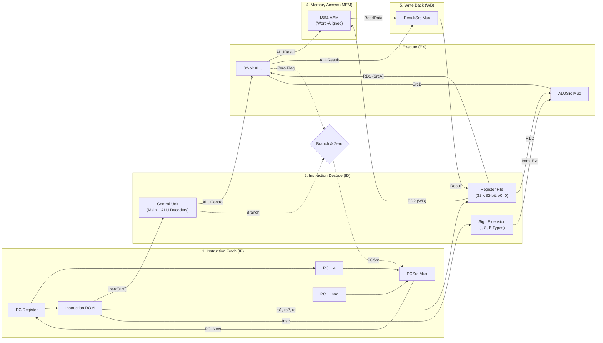

# 🚀 32-Bit Single-Cycle RISC-V (RV32I) Processor Core

A synthesizable, 32-bit single-cycle **RISC-V (RV32I base integer subset)** processor core implemented from scratch in **Verilog HDL**, verified with comprehensive unit testbenches and automated full-system simulations using **Icarus Verilog** and **GTKWave**.

---

## 📌 Architecture Overview

In this single-cycle microarchitecture, every instruction executes in **exactly one clock cycle** ($\text{CPI} = 1$). The processor features the classic 5-stage Harvard datapath (separate instruction and data memories to prevent structural hazards in a single cycle).



---

## 🛠️ Supported Instruction Set (RV32I Subset)

| Instruction | Type | Syntax | Operation | Description |
| :--- | :---: | :--- | :--- | :--- |
| **`ADD`** | R | `add rd, rs1, rs2` | $rd = rs1 + rs2$ | Integer addition |
| **`SUB`** | R | `sub rd, rs1, rs2` | $rd = rs1 - rs2$ | Integer subtraction via 2's complement |
| **`AND`** | R | `and rd, rs1, rs2` | $rd = rs1 \ \& \ rs2$ | Bitwise AND |
| **`OR`** | R | `or rd, rs1, rs2` | $rd = rs1 \ \| \ rs2$ | Bitwise OR |
| **`XOR`** | R | `xor rd, rs1, rs2` | $rd = rs1 \oplus rs2$ | Bitwise XOR |
| **`SLT`** | R | `slt rd, rs1, rs2` | $rd = (rs1 < rs2) \ ? \ 1 : 0$ | Signed Set Less Than |
| **`ADDI`** | I | `addi rd, rs1, imm`| $rd = rs1 + \text{imm}$ | Add immediate |
| **`LW`** | I | `lw rd, offset(rs1)`| $rd = \text{RAM}[rs1 + \text{imm}]$ | Load 32-bit word from memory |
| **`SW`** | S | `sw rs2, offset(rs1)`| $\text{RAM}[rs1 + \text{imm}] = rs2$ | Store 32-bit word to memory |
| **`BEQ`** | B | `beq rs1, rs2, label`| if ($rs1 == rs2$) $\text{PC} = \text{PC} + \text{imm}$ | Branch if equal |

---

## 📂 Repository Structure

```
.
├── rtl/                                # Synthesizable Verilog Design Files
│   ├── alu.v                           # 32-bit ALU with flags (Zero, Carry, OverFlow, Negative)
│   ├── alu_decoder.v                   # ALU operation decoder (funct3, funct7[5], ALUOp)
│   ├── control_unit.v                  # Top control module (Main + ALU Decoders)
│   ├── data_memory.v                   # 1024-word Data RAM (A[31:2] word-aligned)
│   ├── instruction_memory.v            # 1024-word Instruction ROM ($readmemh loader)
│   ├── main_decoder.v                  # Opcode decoder generating datapath control signals
│   ├── mux2.v                          # Parameterized 2-to-1 multiplexer
│   ├── pc.v                            # Program Counter register with synchronous reset
│   ├── pc_adder.v                      # Dedicated 32-bit adder
│   ├── register_file.v                 # 32 x 32-bit registers (x0 hardwired to 0)
│   ├── sign_extend.v                   # Immediate generator for I, S, and B formats
│   └── riscv_single_cycle_top.v        # Top-level integrated processor core
├── tb/                                 # Self-Checking Testbenches
│   ├── tb_alu.v                        # Unit test for ALU operations & overflow
│   ├── tb_register_file.v              # Unit test for dual-read & x0 invariance
│   ├── tb_sign_extend.v                # Unit test for immediate decoding
│   ├── tb_control_unit.v               # Unit test for control signal generation
│   └── tb_top.v                        # Full processor system integration testbench
├── sim/                                # Simulation Artifacts & Scripts
│   ├── memfile.hex                     # Machine code hex test program
│   ├── run_sim.ps1                     # One-click PowerShell compilation & run script
│   └── riscv_top.vcd                   # GTKWave simulation trace dump
└── README.md
```

---

## ⚡ Key Engineering & Design Enhancements

1. **Hardware-Enforced Invariant on `x0`**:
   In RISC-V specifications, register `x0` must always be zero. The register file explicitly prevents overwrites to `x0` and always outputs `32'b0` when reading address `5'd0`.
2. **Mathematically Sound SLT Comparison**:
   Naive implementations evaluate $A < B$ solely by checking sign bit `Sum[31]`, which produces errors during arithmetic overflow. This core computes:
   $$\text{SLT} = \text{Sum}[31] \oplus \text{OverFlow}$$
3. **Dedicated Branch Target Hardware**:
   Full support for conditional branching (`BEQ`) with branch target calculation:
   $$\text{PC\_Target} = \text{PC} + \text{Imm\_Ext}$$
   $$\text{PCSrc} = \text{Branch} \ \& \ \text{Zero}$$
4. **Clean Word Alignment**:
   Memory addressing properly handles byte-to-word translation using `A[31:2]`.

---

## 🧪 Simulation & Verification

### Prerequisites
* [Icarus Verilog (`iverilog`)](https://steveicarus.github.io/iverilog/)
* [GTKWave](https://gtkwave.sourceforge.net/) (for waveform viewing)

### Run Full System Simulation
```powershell
# Using the provided PowerShell script:
.\sim\run_sim.ps1

# Or run directly via iverilog:
iverilog -o sim/tb_top.vvp rtl/*.v tb/tb_top.v
vvp sim/tb_top.vvp
```

### Automated Verification Output
```
===============================================================================
          STARTING FULL RISC-V PROCESSOR SYSTEM SIMULATION                     
===============================================================================
 Cycle |    PC    |   Instr   | ALUResult | WriteData |  Result   | MemWrite       
-------+----------+-----------+-----------+-----------+-----------+----------------
    0  | 00000004 | 00a00113  | 0000000a  | 00000000  | 0000000a  |    0
    1  | 00000008 | 00700193  | 00000007  | 00000000  | 00000007  |    0
    2  | 0000000c | 00208233  | 0000000f  | 0000000a  | 0000000f  |    0
    3  | 00000010 | 401102b3  | 00000005  | 00000005  | 00000005  |    0
    4  | 00000014 | 0020f333  | 00000000  | 0000000a  | 00000000  |    0
    5  | 00000018 | 0020e3b3  | 0000000f  | 0000000a  | 0000000f  |    0
    6  | 0000001c | 0020a433  | 00000001  | 0000000a  | 00000001  |    0
    7  | 00000020 | 00402223  | 00000004  | 0000000f  | 00000004  |    1
    8  | 00000024 | 00402483  | 00000004  | 0000000f  | 0000000f  |    0
    9  | 00000028 | 00508463  | 00000000  | 00000005  | 00000000  |    0
   10  | 00000030 | 02a00593  | 0000002a  | 00000000  | 0000002a  |    0
===============================================================================
                     FINAL ARCHITECTURAL STATE CHECKS                          
===============================================================================
[PASS] ADD Result: Register x4 = 15 (Expected: 15)
[PASS] SUB Result: Register x5 = 5 (Expected: 5)
[PASS] SW Result: Data_Memory[1] = 15 (Expected: 15)
[PASS] LW Result: Register x9 = 15 (Expected: 15)
[PASS] BEQ Branch Succeeded: Skipped x10 (still 0), Executed x11 = 42
===============================================================================
               SIMULATION COMPLETED SUCCESSFULLY!                              
===============================================================================
```

### View Waveforms
```powershell
gtkwave sim/riscv_top.vcd
```

